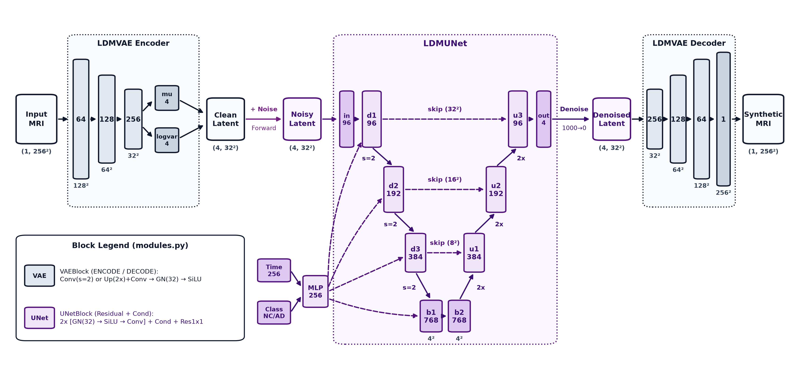
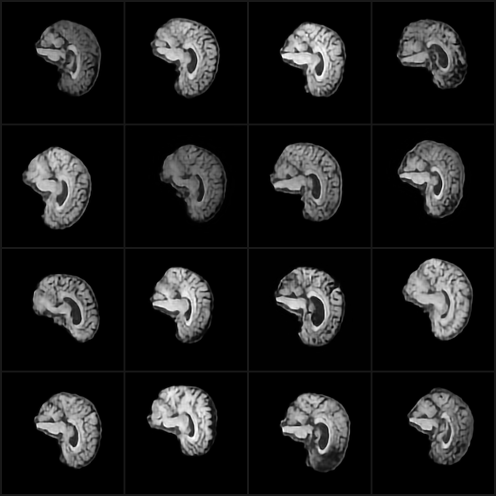
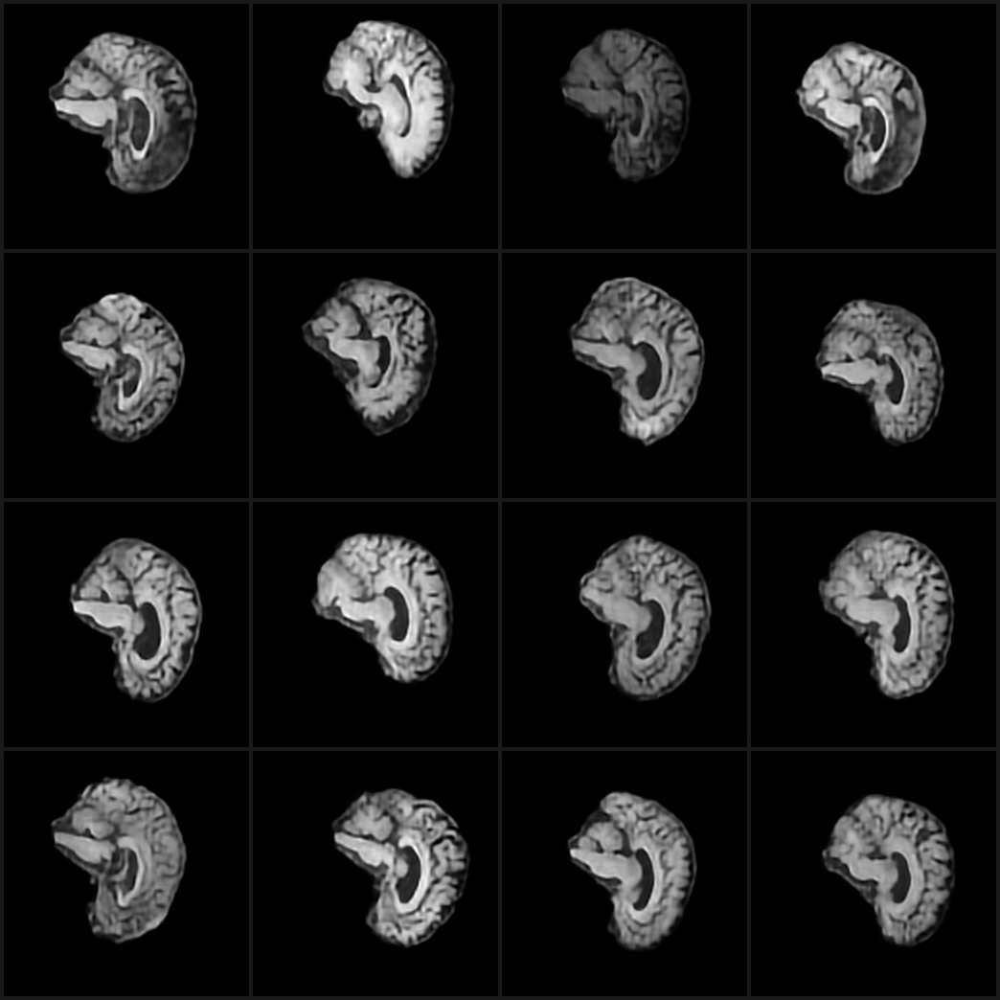
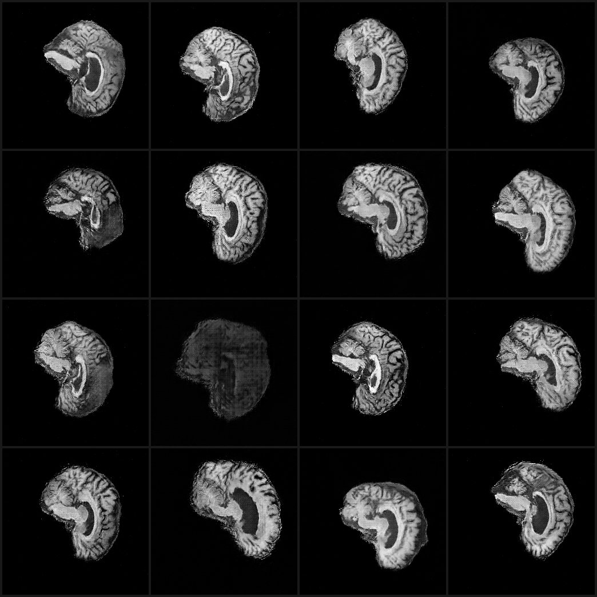
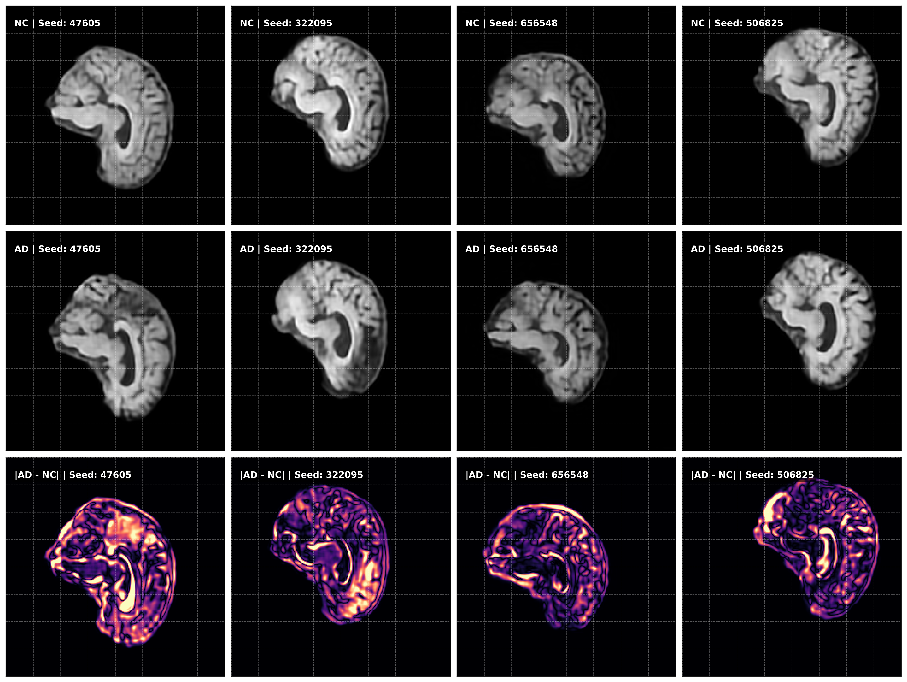
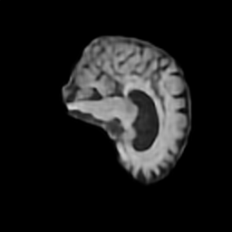
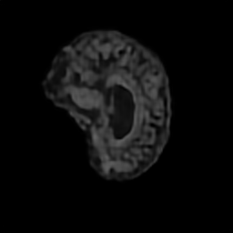
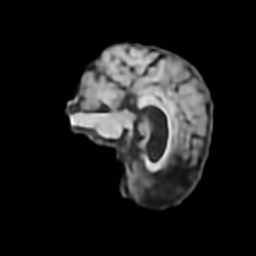

# Latent Diffusion Modelling for Synthetic Medical Cohorts
**Author:** Benigno Della Bosca \
**Course:** COMP3710 Pattern Recognition and Analysis

## Motivation
Currently, access to clinical datasets requires strict patient confidentiality protection, offering limited availability of high-resolution, open-access, legal
medical data, limiting the frequency and quality of research. The emergence of generative models is promising in producing synthetic anatomical models without
the patient privacy concerns of protected health information. The ideal artificial inferences in this application would be genuinely novel and thus have no need
for anonymisation.

We investigate the latent diffusion model (LDM) as one such generative architecture [4] as a method of synthesising these cohorts and their utility by exploring anatomical
conditioning for classical medical machine learning applications. To restrict the domain, the model is trained exclusively on preprocessed ADNI 2D sagittal brain MRI slices, and evaluated on its ability to preserve the biomarkers associated with binary class conditioning of cognitively normal and Alzheimer's diseased patients (NC vs. AD) injected into the synthesis pipeline.

A desirable model will show that indeed, the LDM is discerning enough to produce synthetic cohorts that display characteristics of their
conditioning while avoiding utility- or privacy-violating behaviours such as:

1. **Mode collapse** – a failure to produce varied generative outputs
2. **Hallucination** – a failure to produce medically usable anatomical models
3. **Memorisation** – a violation of the patient confidentiality inherited from the ADNI dataset

## Architecture
See [`modules.py`](modules.py).



The latent diffusion model uses a two-stage setup: the initial variational autoencoder (VAE) and a denoising UNet. The VAE uses a 3-block encode and decode process, using GroupNorm and SiLU activation functions to prevent neuron death and non-smooth training curves. Vectors in the latent space are 4-channel, $32 \times 32$ latent encodings which are reconstructed and evaluated via an L1, SSIM, and KL custom loss function for backpropagation. The UNet is a 4-layer model which accepts noisy latent space encoding volumes and processes them via dual-convolution downsampling blocks with class and timestep conditioning before passing through a double bottleneck and upsample blocks with skip connections. The UNet outputs a timestep-dependent noise prediction (used in inference to iteratively denoise), which is learned via a Smooth L1 loss function.

\newpage

## Feasibility Report
A preliminary feasibility report was constructed as an initial outline of the problem space and solution requirements.

### User Need, Scope & Acceptance Criteria
The primary objective of this project is to produce a model capable of synthesising artificial medical cohorts for applications in lieu of patient data privacy laws. Considerations may be categorised as follows:

1. **Adherence to privacy:** A viable product must not result in any data leakage or possible reverse engineering of the original dataset. This model will essentially behave as a bridge between protected clinical datasets and unrestricted access to a new non-human cohort. 
2. **Utility:** A viable product must behave as a reasonable stand-in for real data; as such, anatomical structural validity must be preserved (as well as believable abnormalities).

The dataset being used is a pre-processed ADNI sagittal brain MRI dataset consisting of slices in the centre of the hemispheres. The model must synthesise a slice from this region at a level of granularity that preserves the following:

1. Crisp edges of Sulci and Gyri folding $\rightarrow$ Important biomarker for non-CN samples
2. Distinct White and Gray matter $\rightarrow$ Improper matter synthesis can impact utility
3. Ventricle size and expansion $\rightarrow$ Another important biomarker for non-CN samples
4. Visible branching in Cerebellum slices $\rightarrow$ Goal for visible appraisal accuracy; branches have sub-millimetre thickness

We also wish to produce cognitively normal and diseased synthetic samples on command, like how the Stable Diffusion models converge their output via text-encoded input.

> Tutor noted that these criteria would be too much; reduced to just ventricle and gyri anatomy for final product.

### Model Choice & Course Concepts
The model chosen for this project is a latent diffusion model which, unlike the adversarial nature of the GAN, can be broken into two distinct sub-problems:

**The VAE:** Constructs a latent space representation of encoded samples, crucial for the "understanding" of anatomical structures. 

1. Micro-augmentations of data every epoch (rotations) $\rightarrow$ mitigating memorisation
2. Encoding $1 \times 256 \times 256$ (grayscale channel) to $4 \times 64 \times 64$ latent space possibly using residual connections
3. Loss: ELBO (KL + MSE)
4. Partitioned test set for validation halting (approx. half test set patient split)

FID, SSIM & UMAP post-training $\rightarrow$ A healthy VAE does not need to be revised when attempting denoising.

> Latent space was changed to $4 \times 32 \times 32$ without residual connections for ease of implementation and to reduce training time. \
> Loss was changed to MAE loss in an attempt for sharper reconstructions; a contrasting SSIM term was also added.

**The UNet:**

1. Encoding $4 \times 64 \times 64$ (encoded sample space) $\rightarrow$ $512 \times 8 \times 8$ feature space
2. Adaptive group normalisation (timestep noisiness and binary disease presence CN vs. AD)
3. Loss: MSE

> This was changed into a $4 \times 4$ feature space and instead used an added MLP condition injection rather than the adaptive normalisation seen in literature such as [3].

The result should be a denoising model that can be fed noise and progressively converge on a synthetic, non-memorised, granular, anatomically correct, unique (non-mode-collapsed) MRI sample which presents as the desired conditioning.
Synthetic samples can again be evaluated using a UMAP as well as potentially Jacobian Index Mapping. Additionally, it may be noted that the ConvNeXt and GFNet projects intend to (potentially) diagnose diseased and cognitively normal samples from the same dataset; a future experiment may use one of these models to validate the accuracy of conditioning on synthesis. 

> Index mapping was not performed, nor investigation into the utility of the cohort in other ML tasks.

### Risks, Budget & Fallback
The primary risk of this project is a failure to produce a solution which effectively protects the dataset and privacy of patients; issues such as mode collapse, memorisation, and other forms of patient confidentiality breaching are considered legal and ethical risks were the weights to be made public. If such an event does occur, it should be made clear that the weights are not public and reproducing a model using the provided source code will result in a malformed model. For fallback, the project is designed to be completed in two parts: failing to produce a valid UNet will not impact a healthy VAE; in the case that the denoising model is invalid, further attempts can be made using the frozen VAE weights. The computing budget is large over a 20,000+ dataset (on slices); batching will be necessary to speed up computation, but parallelisation will be costly for the VRAM. The intended GPU, A100, should be able to handle 32–64 batches; however, it may be worth considering pre-encoding all images in the dataset at a major overhead cost so that per-epoch latent space calculations are streamlined. A downside of this is that per-epoch augmentation cannot be performed on the UNet, which may allow memorisation. The fallback is to save weights during training and sacrifice a streamlined timeline for longer, costly bursts of train time.

> The UNet does indeed receive augmentation, but as identified this does not refresh per epoch; this is revisited in the degenerate case autopsy.

## How to Use
**Dependencies:**

- Python 3.11
- PyTorch (CUDA recommended, mostly trained on 4060 Ti)
- `matplotlib`, `torchmetrics`, `numpy`, `Pillow`, `pytorch-ignite`, `scipy`

It is recommended to create a symlink to the ADNI dataset in this directory; the directory
is also assumed to follow the structure:

```text
ADNI/
\-- AD_NC
    +-- test
    |   +-- AD
    |   \-- NC
    \-- train
        +-- AD
        \-- NC
```

A full training script has been provided ([`train.sh`](train.sh)) but requires a bash environment to run. It will execute a 100-epoch VAE train + 300-epoch UNet train: \
`./train.sh ADNI`

Alternatively, models can be trained individually using Python: \
`python train.py ADNI --vae` \
`python train.py ADNI --unet`

Inference (synthesis) can be performed using the [`predict.py`](predict.py) script, populating a `gan_out` and `ldm_out`
directory with the generated cohorts: \
`python predict.py`

> Note that training the UNet requires VAE weights `"vae_weights.pt"` to exist inside the directory.

### Preprocessing
Per-epoch training datasets for the VAE underwent a transformation involving a rotation, translation, and brightness augmentation. 
The intention was to introduce enough reasonable MR imaging variance to prevent the model from effectively learning patient
anatomies and causing memorisation of dataset slices. In addition to this, a second dataloader was constructed to pre-encode the
latents from the training dataset to optimise the VRAM usage and load times during the UNet training loop. 

\newpage

## Investigation of Open Research Dilemma: Evaluation and Metrics

Following training, an inference stage was run generating a DCGAN baseline cohort of
200 synthetic samples as well as 200 (100 AD, 100 NC) diffusion model samples. Shown below
are non-cherry-picked random samples from each of the respective cohorts. All evaluation 
metrics were calculated using these cohorts.

The evaluation metrics used are SSIM and FID calculations, each chosen to target quality
criteria outlined in the research motivation. The first criterion, mode collapse, is
damage to the diversity over generated cohorts and can be evaluated using an average pairwise SSIM
across the entire cohort; collapsed synthesis should manifest as high average pairwise SSIM.
Memorisation, alternatively, requires indexing all SSIM metrics across the training set to ensure
the nearest neighbour of a synthetic sample is not an exact match; the test set metrics were
also calculated as a baseline that is not at risk of being learned by the model. Finally, the FID metric
is used to evaluate the quality and diversity of features synthesised in comparison to the truth slices.
Because the pixel majority of MRI slices compose a void background, small noise is zeroed to best match conventional
MRI processing.

| LDM (NC) | LDM (AD) | DCGAN |
| :---: | :---: | :---: |
|  |  |  |

| Model Architecture | Pairwise SSIM | Train NN Mean (Max) | Test NN Mean (Max) | Domain FID (Raw) | Domain FID (Clamped) |
| :--- | :---: | :---: | :---: | :---: | :---: |
| **DCGAN Baseline** | 0.6598 | 0.7298 (0.8063) | 0.7243 (0.7948) | 0.3972 | 0.3378 |
| **Latent Diffusion** | 0.7042 | 0.7713 (0.8573) | 0.7626 (0.8164) | 0.4234 | 0.4119 |

### Pairwise SSIM
Both the DCGAN and LDM report an average cohort SSIM >0.6, with the DCGAN baseline
exhibiting a lower score than the diffusion model. Lower pairwise SSIM can indicate that the diversity
of the cohort has a higher variance, and less likelihood of mode collapse. However, the
context of synthetic samples should also be considered: the LDM attempts to generate
latent space encodings of true anatomical structures, whereas the GAN is purely managing
an equilibrium of the discriminator and generative models. This manifests as sharp, but
hallucinated structures in the GAN output and fuzzier, but more anatomically reasonable structures
in LDM output. A large portion of anatomical structure is similar across samples; consider the
image-to-image variance in other synthesis-focused datasets such as CelebA and other
highly conditioned image sets. 

### Nearest-Neighbour
The LDM reports very slightly higher train set nearest-neighbour SSIM than its test set
inference; in memorisation cases it is expected that this difference would be large, but
the competent inference on non-training data is promising that memorisation is unlikely.
Additionally, the performance is quite close to the DCGAN baseline; considering the restrained
train time and parameters of this model, the more aggressive pipeline of the LDM is
demonstrating that this model's learning is not replicating training data, preserving the
privacy of physical patient anatomical uniqueness, and instead does produce novel,
synthetic cohorts. It should be noted that due to the preprocessing supplied, it was not entirely confirmed if train and test sets were patient-disjoint; case separation was identified so no duplicate MRI exists in these sets. Further research should address this with rigorous checking.

### Fréchet Distance
Rather than an external model, we review the Fréchet distance calculations based on the latent space of the VAE sub-model of the LDM. Here, specific MRI features would be involved in metric calculations instead of generalised image recognition feature spaces. Interestingly, the GAN performs better in this metric compared to the LDM; despite the diffusion model having access to explicit latent space encodings during its denoising training, we can interpret this as a suboptimal performance of the UNet architecture. This indicates a potential for fine-tuning for the diffusion process to close the gap between its synthesis and the features present in the VAE. Additionally, it is possible the crisp anatomies of the GAN, although hallucinated, matched the VAE expectations for contrast and were disproportionately rewarded for it.

### Conditional Synthesis


The evaluation for class conditioning was done by performing inference on a fixed noise
vector for both the NC and AD; additionally, a difference heatmap, adapted from techniques
in [1], was used to measure inference differences influenced by conditioning. Given the fixed
noise, all differences in synthesis are solely attributed to the class conditioning over the denoising process. We can confirm the effect of conditioning *prima facie*: the slice anatomy is indeed influenced while still retaining macro features such as slice index, position, rotation, and structures.
From the heatmap we can observe that ventricle enlargement occurs in most of the AD slices, which is a biomarker associated with Alzheimer's disease. However, it is difficult to draw any conclusions about sulci widening in this sample set.

### Resource Profiling
See [`evidence/training.log`](evidence/training.log) for the entire log of the training pipeline.

The final train, excluding inference and metric times, was approximately 2.5 hours for the VAE training over 100 epochs with loss dropping from 0.0444
to 0.0088, with a smooth descent in L1 and an initial steep drop in SSIM and KL loss before smoothing out as well. From approximately epoch 80 onward, loss stayed
relatively the same. The UNet ran for approximately 3 hours with an initial 0.0927 loss dropping to 0.0339 at the end of training.

\newpage

### Failure Case Autopsy
| Failure 1 (AD) | Failure 2 (NC) | Failure 3 (NC) |
| :---: | :---: | :---: |
|  |  |  |

- **Failure 1 (AD):** This degenerate case suffers from a hallucination of anatomical structure in the frontal lobe; the synthesis has failed to generate any gyral folding, which is an anatomical impossibility. Other degenerate synthetic slices also suffer from this issue; it is possible this is a failure in the VAE to properly encode gyral folding. Comparatively, the GAN in its limited training loop was able to reconstruct gyral folding, although hallucinated, consistently. This is due to the discriminator effectively learning to punish smooth or unconfident generators. Conversely, the VAE has no equivalent loss term to learn this.
- **Failure 2 (NC):** Here, the brightness of this slice has failed to manifest in the proper range of a usable synthetic MRI. This is possibly an artifact from the training dataset, but another possibility is the per-epoch preprocessing of truth slices involved a brightness transform to aid in mitigating memorisation of repeated training data; if this transformation was too aggressive, it could lead to failed artificial samples.
- **Failure 3 (NC):** This degenerate case contains an artifact that was observably present in the training dataset; the VAE has learned to encode these imaging artifacts and the UNet has inherited these degenerations in the denoiser.

## Engineering Recommendation
As presented, these synthetic slices are not appropriate for usage in medical cohort contexts; this product does not reach a level of quality that replicates all conditioning biomarkers at a resolution of detail that would offer utility as a dataset for other machine learning applications (e.g., segmentation, classification, etc.). While it is shown that this methodology is not a medical-grade solution, it can be noted that this model is promising in offering privacy-focused attributes without the sacrifice of learned anatomical structures. As stated previously, further experiments with an updated pipeline containing a discriminator-based architecture similar to the GAN or even a conventional transformer diffuser architecture [3] may prove useful in reducing the softness/blurriness trade-off that is part of the VAE trade-off in reconstructing neural anatomies. 

## AI Usage Disclosure
The Antigravity client was used to assist in code production and conceptual understanding;
the models used were Gemini 3.8 Flash and Claude Opus 5.5.

Primary construction of [`train.py`](train.py), [`modules.py`](modules.py), and [`gan.py`](gan.py) was handwritten, incorporating
additions from the suggestions of these models. [`predict.py`](predict.py) was initially handwritten, with
assistance in reconstructing the reverse diffusion process from papers and pre-existing
algorithms. Code to which AI was given write access has been denoted by changing the
`"Authored by"` section at the beginning of files. The evaluation scripting was heavily
AI-assisted in order to produce a fast enough solution that could manage high-inference,
memory-heavy pipelines for evaluation metrics which could not be met with initial handwritten
solutions.

AI code was verified and tested in a variety of ways. For dense blocks of code, alternate
agents were created to evaluate the output of previous agents. In addition to this,
tasks such as reverse diffusion and network architecture could be quantified by visual
impacts on output; e.g., the diagnosis of checkerboard artifacts in LDM synthesis and
the recommendation of Upsample blocks to replace transposed convolutions could be empirically tested
by retraining the UNet weights. Additionally, diff suggestions were reviewed and scrutinised
for relevance and usefulness; e.g., a strong recommendation of the AI was to use a continuous
denoiser, but this was ultimately rejected and overridden in favour of a discrete noise model [2].

\newpage

## Citations
[1] S. Liu et al., “Structure Guided Manifolds for Discovery of Disease Characteristics,” 2022. [Online]. Available: http://arxiv.org/abs/2209.11015

[2] J. Ho, A. Jain, and P. Abbeel, “Denoising Diffusion Probabilistic Models,” 2020. [Online]. Available: http://arxiv.org/abs/2006.11239

[3] W. Peebles and S. Xie, “Scalable Diffusion Models with Transformers,” 2023. [Online]. Available: http://arxiv.org/abs/2212.09748

[4] R. Rombach, A. Blattmann, D. Lorenz, P. Esser, and B. Ommer, “High-Resolution Image Synthesis with Latent Diffusion Models,” 2022. [Online]. Available: http://arxiv.org/abs/2112.10752
